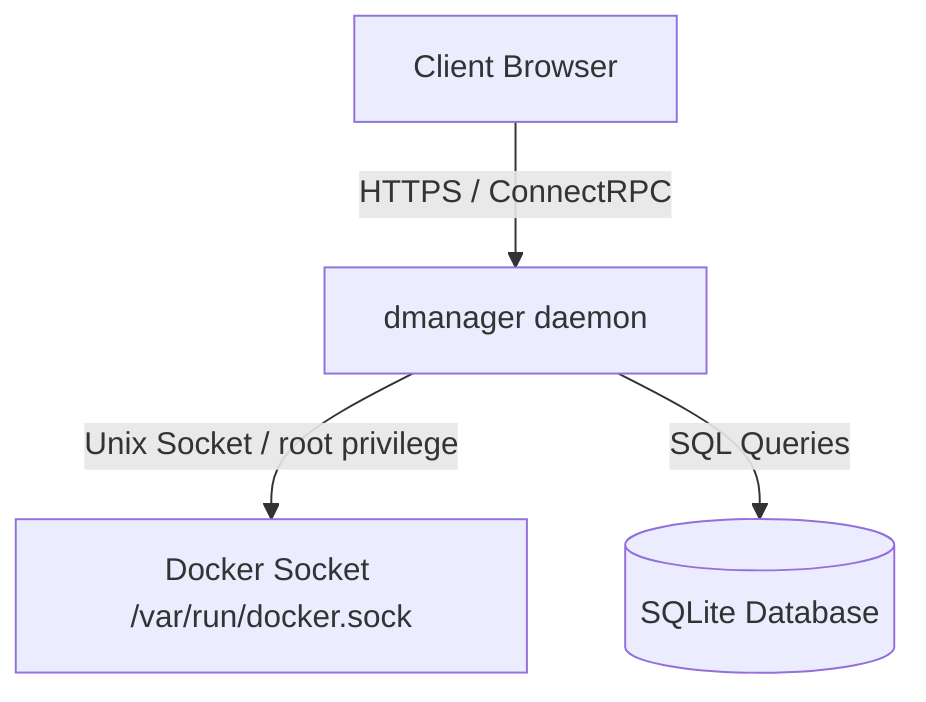

# Security Design & Audit Guidelines

This document outlines the security architecture, threat model, and validation checklists for the `dmanager` application. Because this application interacts directly with the host's Docker socket, maintaining strict security boundaries is critical.

---

## 1. Threat Model & Security Boundaries

### 1.1. Host System Control (Privilege Escalation)
* **Risk:** The Docker daemon socket `/var/run/docker.sock` allows full root-level control over the host system. Anyone who can execute arbitrary Docker commands can mount host root directories and escalate privileges.
* **Mitigation:**
  * The Docker socket must never be exposed directly to the network or the frontend.
  * Only the `dmanager` Go backend communicates with the socket.
  * Every backend endpoint that interacts with the Docker SDK must enforce strict user authentication and authorization checks.

### 1.2. Onboarding & Setup Bypass
* **Risk:** An attacker could invoke the administrator onboarding endpoint (`SetupAdmin`) on a running server to create a secondary admin account or override credentials.
* **Mitigation:**
  * The `SetupAdmin` handler must query the SQLite database first. If the `users` table contains one or more records, the server must reject the call immediately with a `FailedPrecondition` error (Status Code: `9`).

---

## 2. Authentication & Session Management

### 2.1. Password Hashing & Policy
* **Standard:** All passwords must be hashed using **bcrypt** with a minimum work factor (cost) of `12`.
* **Password Policy:** Minimum length of `12` characters and maximum of `72` bytes (bcrypt's input limit). Passphrases are recommended; no arbitrary composition or special character rules (per NIST SP 800-63B guidelines).
* **Breached Password Verification:** Optional HIBP k-anonymity check (`auth.breached_password_check`, disabled by default). When enabled, validates hashes via range API without sending full plaintext or hashes. Fails open on upstream network issues to preserve availability.
* **Verification:** Raw passwords must never be stored in the database or logged under any circumstances.

### 2.2. Session Token Generation & Two-Clock Lifecycle
* **Standard:** Session identifiers must be generated using a cryptographically secure random number generator (`crypto/rand` in Go) with a length of 32 bytes, encoded as a 64-character hexadecimal string.
* **Storage & Lifetimes:**
  * Sessions are governed by a two-clock model: a sliding idle timeout (`expires_at`, default: 7 days, 30 days for "Remember me") and an absolute expiry cap (`absolute_expires_at`, default: 30 days, 90 days for "Remember me").
  * Sliding activity updates occur lazily (only after half of the idle timeout has elapsed) to minimize database write churn.
  * Expired sessions (by either idle or absolute deadline) are rejected upon access and cleaned up by a recurring background purge job.

### 2.3. Transport Cookies
* **Standard:** The session token must be transmitted via HTTP headers using `Set-Cookie`.
* **Cookie Flags:**
  * `HttpOnly`: Prevents client-side scripts (XSS) from reading the token.
  * `Secure`: Configurable mode (`auto`, `always`, `never`). In `auto` mode, enforced whenever the request is served over HTTPS or carries `X-Forwarded-Proto: https`.
  * `SameSite=Lax`: Mitigates Cross-Site Request Forgery (CSRF) while allowing normal top-level navigations.
  * `Max-Age`: Matches the idle session timeout to synchronize browser-side and server-side expiration.
  * `Path=/`: Restricts cookie scope to the root path.

### 2.4. Rate Limiting & Timing Side-Channel Mitigation
* **Timing Equalization:** `Login` performs a dummy bcrypt hash comparison on username misses to equalize execution duration between valid and non-existent usernames.
* **Rate Limiting:** Failed login attempts are throttled using in-memory sliding window counters tracked independently per source IP and per username. The username counters are kept per sign-in method (password and passkey), so wrong passwords never lock a user out of passkey sign-in, a successful passkey sign-in does not clear password failures, and the reverse; the IP counters are shared across methods, so one address still hits the limit whichever method it fails with. Passkey failures that happen before the account is known (bad or expired challenge, unknown credential) count against the source IP only, never against a username, so they cannot lock passkey sign-in for anyone else. 5 failures trigger exponential lockout backoff (1m, 2m, 4m, 8m, capped at 15m), returning `ResourceExhausted` with retry metadata.
* **Passkey Begin Throttle:** `BeginPasskeyLogin` is unauthenticated and stores a challenge per call, so each source IP is limited to 20 calls per sliding minute (`ResourceExhausted`; one `rate_limited` audit event per IP per window). This limit is separate from the failure lockout and never locks a user out. Challenges are purged every minute and looked up through a unique `(kind, challenge)` index. The throttle's own memory and audit output are bounded: at most 10,000 IPs are tracked (further IPs share one limited overflow key) and at most 30 `rate_limited` begin events are written per minute in total. **Behind a reverse proxy, set `server.trusted_proxy` correctly** so the real client address is used; without it every client shares the proxy's address and the 20-per-minute begin limit applies to all of them together.

### 2.5. WebAuthn & Passkey Security Model
* **Relying Party (RP) Binding:** `rp_id` and `origins` must be statically pinned in configuration. Origins are never dynamically derived from request headers to prevent DNS rebinding or origin spoofing attacks.
* **Discoverable Resident Keys:** Usernameless login uses resident keys (`resident_key = required`; a credential reported as non-discoverable via `credProps` is rejected at registration) with empty `allow_credentials` on `BeginPasskeyLogin`, allowing platform authenticators to resolve the user handle. The user handle is a random, opaque 32-byte per-user value (`users.webauthn_user_id`); users who registered passkeys before it existed keep the legacy 8-byte row-ID handle, because their authenticators stored it. See [authentication.md](authentication.md) §4.
* **Challenge Lifetimes & Single-Use:** Cryptographic challenges have a 120-second TTL stored in SQLite, enforced at single-use (`consumed = 1`, set by one atomic conditional UPDATE so concurrent finish calls cannot both succeed), and purged periodically.
* **Generic Sign-in Failure:** every `FinishPasskeyLogin` verification failure (unparseable response, unknown or expired challenge, unknown credential, failed assertion) returns the same `Unauthenticated` message, "passkey sign-in failed", so a caller holding a valid challenge cannot tell the cases apart and no library detail reaches the browser. The specific reason is kept in the `login_failed` audit event. Rate limiting still answers `ResourceExhausted` with a retry time.
* **Browser Availability:** the UI disables the passkey buttons, with an explanation, when the page is not a secure context or the browser lacks `PublicKeyCredential`. Dismissing the browser prompt or a timeout (`NotAllowedError`, `AbortError`) is treated as a quiet cancel, not an error.
* **Clone Detection:** Authenticator signature counter (`sign_count`) is tracked per credential. If the library sees a regression (a newly asserted count that is not above the recorded one, unless both are 0, which includes a drop to 0), the login is still allowed but the credential is flagged with `clone_warning = 1`, the new count is stored, and a `passkey_clone_warning` audit event is written. It does not count toward login rate limiting. Counters can legitimately reset (restored backups, some providers), so this is a warning rather than a rejection. The flag stays until the passkey is deleted; Settings shows a badge, and if the regression is unexpected, deleting the passkey and registering it again is the fix.
* **Passkey user verification:** `webauthn.require_user_verification` (`DMANAGER_WEBAUTHN_REQUIRE_USER_VERIFICATION`) defaults to `preferred`.
  * `preferred`: the authenticator decides whether to verify the user. A security key without a PIN, or a password manager that is already unlocked, can sign in with one confirmation, so for such passkeys possession is the only factor. This keeps passkeys usable on the widest range of devices.
  * `required`: every sign-in and registration must carry a user verification (the authenticator's PIN or biometric, or a password manager's unlock check); assertions without it are rejected. Set `webauthn.require_user_verification: required` (or the environment variable) and restart. It applies to new ceremonies, and passkeys that cannot verify a user will stop working, so register verifying ones first.
  * `discouraged`: the verification prompt is not requested.
  * The real flag is stored per passkey at registration, and Settings shows "No User Verification" on passkeys registered without it. Passkeys that existed before this was recorded are assumed to have been verified, because that cannot be checked afterwards.
* **Sessions on passkey removal:** `DeletePasskeyRequest.sign_out_other_sessions` revokes every other session of the user in the same request (the current session stays) and writes a `session_revoked` audit event (`reason: passkey_removed`). The Settings delete dialog offers it as "Also sign out all other sessions", ticked by default, so a session created with a lost or stolen passkey does not outlive it. Adding or deleting a passkey does not ask for re-authentication; a valid session is enough.
* **Lockout Guardrails:** Users cannot delete their last remaining authentication factor (e.g. deleting the last passkey when no password exists).

---

## 3. Authorization & Access Control (RBAC)

### 3.1. User Roles
The system supports two user roles:
1. `admin`: Full privileges to manage containers, execute lifecycles/updates, change system settings, and trigger notification tests.
2. `viewer`: Read-only access to view the dashboard and stream logs. Cannot mutate container states, and cannot read or update settings or registry status (the settings response includes the Gotify token).

### 3.2. Endpoint Access Control Matrix

| Endpoint | Service | Minimum Role | Authentication |
| :--- | :--- | :--- | :--- |
| `GetServerStatus` | `AuthService` | None | Unauthenticated |
| `SetupAdmin` | `AuthService` | None | Unauthenticated (Only if user count is 0) |
| `Login` | `AuthService` | None | Unauthenticated |
| `BeginPasskeyLogin` | `AuthService` | None | Unauthenticated |
| `FinishPasskeyLogin` | `AuthService` | None | Unauthenticated |
| `Logout` | `AuthService` | `viewer` | Authenticated |
| `GetMe` | `AuthService` | `viewer` | Authenticated |
| `BeginPasskeyRegistration` | `AuthService` | `viewer` | Authenticated |
| `FinishPasskeyRegistration` | `AuthService` | `viewer` | Authenticated |
| `ListPasskeys` | `AuthService` | `viewer` | Authenticated (Own passkeys only) |
| `RenamePasskey` | `AuthService` | `viewer` | Authenticated (Own passkeys only) |
| `DeletePasskey` | `AuthService` | `viewer` | Authenticated (Own passkeys only; lockout guardrail) |
| `ListAuthEvents` | `AuthService` | `viewer` | Authenticated (Viewer sees own; Admin sees all) |
| `ListSessions` | `AuthService` | `viewer` | Authenticated (Own sessions only) |
| `RevokeSession` | `AuthService` | `viewer` | Authenticated (Own session only) |
| `RevokeAllOtherSessions` | `AuthService` | `viewer` | Authenticated (Own sessions only) |
| `ListContainers` | `ContainerService` | `viewer` | Authenticated |
| `GetContainerLogs` | `ContainerService` | `viewer` | Authenticated |
| `StreamContainers` | `ContainerService` | `viewer` | Authenticated |
| `StartContainer` | `ContainerService` | `admin` | Authenticated + Admin |
| `StopContainer` | `ContainerService` | `admin` | Authenticated + Admin |
| `UpgradeContainer` | `ContainerService` | `admin` | Authenticated + Admin |
| `SetContainerAutoUpdate` | `ContainerService` | `admin` | Authenticated + Admin |
| `CheckContainerUpdates` | `ContainerService` | `admin` | Authenticated + Admin |
| `GetSettings` | `SettingsService` | `admin` | Authenticated + Admin |
| `GetRegistryStatus` | `SettingsService` | `admin` | Authenticated + Admin |
| `UpdateSettings` | `SettingsService` | `admin` | Authenticated + Admin |
| `TestGotifyNotification` | `SettingsService` | `admin` | Authenticated + Admin |
| `GetSystemLogs` | `LogService` | `viewer` | Authenticated |
| `SyncLogs` | `LogService` | `viewer` | Authenticated |

---

## 4. Input Validation & Injection Defenses

### 4.1. Command Injection Prevention
* **Standard:** `dmanager` must never execute shell commands (e.g. `exec.Command("docker", ...)`) with user-supplied arguments.
* **Implementation:** Always interact with Docker using the official structured Go **Docker SDK** client.

### 4.2. Container ID Validation
* **Standard:** All endpoints receiving container IDs (like `StartContainerRequest.id`) must validate that the ID matches a standard Docker SHA256 hex string pattern (64 characters, `^[a-fA-F0-9]{64}$`) or a valid container name before passing it to SDK functions.

### 4.3. SQL Injection Prevention
* **Standard:** Direct string concatenation of SQL commands is strictly forbidden.
* **Implementation:** All queries must be executed using SQLC parameter binding (`?` placeholders).

---

## 5. Network Exposure & Embedded Tailscale Node

The optional embedded Tailscale node (`tsnet`, see docs/tailscale.md) adds a second network path (off unless `tailscale.enabled` is `true`)
to the identical HTTP handler tree. It changes **where** packets can arrive, never **who** the
application trusts:

- **No auth bypass.** Tailnet requests traverse the same session-cookie auth interceptor, RBAC
  (admin/viewer), rate limiting, and audit logging as LAN requests. Tailnet identity restricts
  reachability at the network layer only.
- **Auth key handling.** The key is read from env/YAML, held in memory, never logged, and never
  exposed via RPC or the settings service. Treat it as equivalent to a node invitation; env vars
  are recommended over YAML for compose deployments.
- **State directory.** `tailscale.state_dir` (default `/var/lib/dmanager/tailscale`) stores the
  node's WireGuard private key and machine identity with `0700` permissions — same sensitivity
  class as the SQLite database.
- **Funnel is not wired.** No code path exposes the tailnet listener to the public internet.
- **Failure containment.** A node that cannot start degrades to LAN-only operation with an error
  log; tailnet outages cannot render the manager unreachable.
- **Tailnet HTTPS (optional).** With `tailscale.https_enabled`, the node serves HTTPS only (no plain-HTTP tailnet listener, no fallback if the tailnet lacks MagicDNS/HTTPS certificates), and tsnet terminates TLS in-process
  (Let's Encrypt certificate for `<hostname>.<tailnet>.ts.net`). The HTTPS listener injects
  `X-Forwarded-Proto: https` server-side via middleware — `Set`, never `Add` — so tailnet peers
  cannot spoof the header to influence `secure_cookies: auto`; on that listener https is the
  only truth. Tailnet-scoped TLS keys live in `state_dir` alongside the node identity.
- **Status exposure is identity-only.** `AdminService.GetTailscaleStatus` (any authenticated role)
  reports lifecycle state, DNS name, IPs, ports, and key expiry — data already printed to startup
  logs. It never returns the auth key, node private keys, or peer lists.

---

## 6. Security Checklists for Code Review

Before committing any feature branch, verify the following checks:

### Go Backend (Security Checklist)
- [ ] No raw passwords are logged.
- [ ] Password comparisons are executed using `bcrypt.CompareHashAndPassword`.
- [ ] DB queries use generated SQLC parameters (no raw string formatting in SQL).
- [ ] Connect interceptor verifies session cookie on all protected routes and rejects requests with `Unauthenticated`.
- [ ] Admin actions explicitly check that `User.Role == "admin"` and reject unauthorized users with `PermissionDenied`.
- [ ] SetupAdmin checks `CountUsers` first.
- [ ] Static security checks pass: `golangci-lint run` (specifically runs `gosec`).
- [ ] Secrets (passwords, registry tokens, SMTP credentials, Tailscale auth key) are never written to logs or returned in RPC responses.

### Frontend (Security Checklist)
- [ ] Cookies are managed entirely via backend `HttpOnly` flags (no manual token reads in client javascript).
- [ ] Input fields enforce maximum lengths to prevent buffer or DOS anomalies.
- [ ] Dynamic markup avoids `dangerouslySetInnerHTML` unless explicitly sanitized.
- [ ] All oxlint security checks pass successfully: `pnpm lint`.
